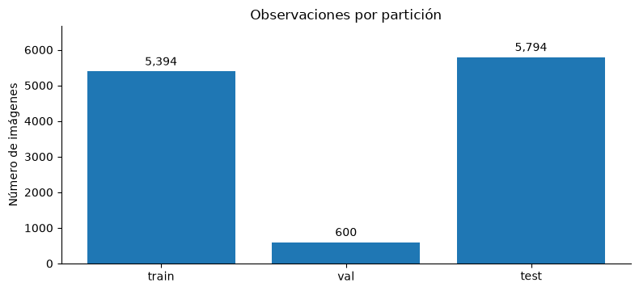

| **Curso** | **Entrega** | **Fecha** |
|:----------|:------------|:----------|
| Deep Learning I | Tarea 01 | 16 de octubre de 2026 |

::: {.callout-note}
## Edición pública

Esta edición reproduce el texto, las tablas y las cifras del informe técnico entregado
(`Informe_Tecnico_CUB200_Deep_Learning_I.pdf`), con dos diferencias:

1. La **Figura 2** del original mostraba cinco fotografías de CUB-200-2011. Aquí se sustituye por una **tabla**
   con los mismos cinco casos. Las fotografías no se redistribuyen porque Caltech indica que no posee sus derechos
   y restringe su uso a la investigación y la educación no comercial.
2. En la **sección 6.3** se explica el motivo de la prueba omitida y se eliminan los tiempos de ejecución de
   pytest, que no coincidían con los *logs* archivados. El resultado se mantiene: 8 pruebas aprobadas y 1 omitida
   por entorno.

**Autoría.** La solución, el código, el notebook y este informe son trabajo académico propio. El enunciado de
la tarea es del docente Héctor Javier Hortúa, PhD (Deep Learning I, Universidad El Bosque).
:::

# Resumen ejecutivo

Se documenta la integración de fotografías, descripciones textuales y atributos tabulares de CUB-200-2011 en seis pipelines de datos: entrenamiento, validación y prueba para PyTorch y TensorFlow. El trabajo se centra en trazabilidad, preprocesamiento, prevención de fuga de información y verificación del contrato multimodal; no incluye entrenamiento ni evaluación predictiva de clasificadores.

El notebook ejecutado registra 11.788 imágenes de 200 especies y diez captions asociadas por imagen. La partición de entrenamiento contiene 5.394 observaciones; la validación, 600; y el test oficial, 5.794. Los datos procesados incluyen 312 atributos binarios y seis variables geométricas. La validación cruzada comparó 6.394 observaciones de validación y test en sus campos deterministas.

| **Indicador** | **Resultado** |
|:--------------|:--------------|
| Imágenes / captions | 11.788 / 117.880 |
| Vocabulario / longitud de secuencia | 2.079 tokens / 25 tokens |
| Tabular | 318 variables (312 binarias + 6 geométricas) |
| Auditoría de cajas | 30 ajustadas (0,254 %); pérdida máxima relativa: 7,98 % |
| PyTorch / TensorFlow | Contrato multimodal: OK en train, val y test |
| Pytest, pruebas recientes | 8 passed, 1 skipped por entorno |

*Fuente de evidencias: notebook principal ejecutado «02_informe_ejecutable_CUB200_FINAL_PORTABLE.ipynb», registros de pytest y comparación exhaustiva incluidos en el ZIP académico. La auditoría final incluyó la inspección estática del código modular en src/cub200/ y los scripts de validación.*

# 1. Objetivo, alcance y pregunta técnica

Objetivo: disponer de conjuntos de datos multimodales para train, val y test en dos ecosistemas independientes, con lotes que unan imagen, tokens de una descripción, longitud real, atributos tabulares, etiqueta de especie e identificador.

Pregunta técnica: ¿es posible generar los seis flujos de datos conservando el protocolo de partición, un esquema uniforme de variables y parámetros de procesamiento ajustados únicamente en entrenamiento?

El alcance termina en la producción y validación de lotes. No se incluyen modelos entrenados, métricas de clasificación ni afirmaciones de rendimiento predictivo.

# 2. Fuentes y unidad de análisis

La fuente visual y las anotaciones proceden de Caltech-UCSD Birds-200-2011 (Wah et al., 2011). Las descripciones textuales se atribuyen a Reed et al. (2016), distribuidas en el conjunto usado en el proyecto mediante el material AttnGAN. La unidad de análisis es image_id, con una fotografía, diez captions, 312 atributos binarios anotados, geometría derivada de la caja delimitadora y etiqueta de especie.

| **Conjunto** | **Observaciones** | **Especies** | **Mín.–máx. por especie** |
|:-------------|------------------:|-------------:|:--------------------------|
| Entrenamiento | 5.394 | 200 | 26–27 |
| Validación | 600 | 200 | 3–3 |
| Test oficial | 5.794 | 200 | 11–30 |
| Total | 11.788 | 200 | — |

{width=78%}

# 3. Metodología de preprocesamiento

## 3.1. Integración y particionamiento

El proyecto conserva el split oficial de test. Sobre las 5.994 observaciones originales de entrenamiento se extrae una validación estratificada de 600 imágenes, tres por especie, utilizando semilla 42. Los registros se vinculan por image_id y relpath. El manifest contiene la asignación a train, val y test.

## 3.2. Imagen

Se utiliza la bounding box de cada fotografía con margen del 10 %, redimensionado a 256 × 256 y recorte final de 224 × 224. En entrenamiento se aplica recorte aleatorio, flip horizontal y variaciones de brillo y contraste. Para validación y test se emplea recorte central, sin aumentación. Las imágenes se normalizan usando las estadísticas ImageNet.

## 3.3. Texto

Las captions se limpian a minúsculas y tokens alfabéticos. El vocabulario se ajusta solo a train, con frecuencia mínima de 2; se reservan `<pad>=0` y `<unk>=1`. La longitud máxima proviene del percentil 95 de train y en la ejecución vale 25. Para train se selecciona aleatoriamente una de las diez captions; para val y test se utiliza la primera.

## 3.4. Variables tabulares

Se mantienen 312 atributos binarios y se añaden seis medidas: centro horizontal y vertical relativos, ancho y alto relativos, relación ancho/alto y área relativa. Únicamente las variables geométricas se estandarizan con un StandardScaler ajustado en train y luego aplicado sin reajuste a val/test.

# 4. Control de calidad y trazabilidad

## 4.1. Integridad y validaciones de datos

Las verificaciones guardadas acreditan unicidad de image_id, 200 clases presentes en cada partición, dimensiones tabulares (11.788, 318), tokens (11.788, 10, 25), longitudes (11.788, 10), ausencia de valores tabulares no finitos y consistencia entre longitud efectiva y padding a la derecha. La media de las seis variables geométricas en train es aproximadamente cero.

La proximidad a cero de la media train es coherente con la estandarización y se complementa con la inspección del código de preparación: el ajuste del escalador, el vocabulario y la longitud máxima se restringen a entrenamiento. La comprobación no demuestra por sí sola ausencia de toda posible fuga de información.

## 4.2. Corrección de bounding boxes

Treinta bounding boxes originales exceden los bordes físicos de alguna imagen (0,254 % del conjunto). Se conservan las anotaciones originales en el manifest y se utiliza una intersección válida para la geometría derivada. La máxima reducción de área de la caja registrada es de 7,98 %. La tabla siguiente resume los cinco casos de la auditoría visual guardada.

| **image_id** | **Especie (carpeta CUB-200-2011)** | **Pérdida relativa de área** |
|-------------:|:-----------------------------------|-----------------------------:|
| 5007 | 086.Pacific_Loon | 7,98 % |
| 1218 | 022.Chuck_will_Widow | 7,27 % |
| 9762 | 166.Golden_winged_Warbler | 1,85 % |
| 999 | 019.Gray_Catbird | 1,61 % |
| 960 | 018.Spotted_Catbird | 1,57 % |

*Figura 2 (edición pública). Cinco casos de clipping de bounding boxes con mayor pérdida relativa de área, calculada como 1 − (área recortada / área original) a partir de `bbox_clipping_audit.csv`. El informe original muestra las fotografías correspondientes, que aquí se omiten.*

# 5. Implementación en ambos frameworks

El notebook referencia src/cub200/pytorch_pipeline.py y src/cub200/tensorflow_pipeline.py como implementaciones nativas. En PyTorch se utiliza un Dataset multimodal y DataLoader; en TensorFlow, la familia tf.data con lectura y transformaciones independientes. La verificación se ejecuta mediante scripts/validate.py en entornos virtuales separados, evitando conflictos de dependencias.

| **Salida** | **PyTorch** | **TensorFlow** |
|:-----------|:------------|:---------------|
| image | (B, 3, 224, 224) | (B, 224, 224, 3) |
| input_ids | (B, 25) | (B, 25) |
| tabular | (B, 318) | (B, 318) |
| lengths, label, image_id | (B,) | (B,) |

# 6. Resultados de verificación

## 6.1. Comprobación ejecutable desde el notebook

La celda de validación ejecuta scripts/validate.py de forma aislada en el intérprete correspondiente de PyTorch y TensorFlow. Al establecer MPLBACKEND=Agg se evita que el backend inline del kernel Jupyter se propague de forma incompatible al subprocess de TensorFlow.

| **Framework** | **Train** | **Val** | **Test** | **Contrato** |
|:--------------|:---------:|:-------:|:--------:|:------------:|
| PyTorch | OK | OK | OK | OK |
| TensorFlow | OK | OK | OK | OK |

El lote comprobado fue de B=16, con imágenes en el orden de dimensiones nativo de cada framework y los demás campos con sus formas esperadas.

## 6.2. Equivalencia entre frameworks

Las firmas exportadas comparan exhaustivamente las 600 observaciones de validación y las 5.794 de test. Los campos image_id, label, input_ids y lengths coinciden exactamente; los 318 atributos tabulares son equivalentes con tolerancia absoluta 1e-6 y tolerancia relativa cero.

| **Partición** | **Observaciones** | **Campos exactos** | **Tabular** |
|:--------------|------------------:|:-------------------|:------------|
| Validación | 600 | IDs, etiquetas, texto, longitudes | atol=1e-6 |
| Test | 5.794 | IDs, etiquetas, texto, longitudes | atol=1e-6 |

Este resultado NO certifica igualdad píxel a píxel de las imágenes ni equivalencia estocástica de las aumentaciones en entrenamiento, porque tales pruebas no se efectuaron. La comparación se limita a los campos deterministas efectivamente exportados.

## 6.3. Pruebas automatizadas

El usuario volvió a ejecutar python -m pytest -q con cada entorno. Las salidas reportan 8 passed, 1 skipped en PyTorch y 8 passed, 1 skipped en TensorFlow. La omisión es esperada: los *smoke tests* de `tests/test_framework_smoke.py` usan `pytest.importorskip`, y en cada entorno se omite el del framework que no está instalado. En `.venv` se omite la prueba de TensorFlow y en `.venv-tf`, la de PyTorch.

# 7. Limitaciones y discusión

- Las bounding boxes y los 312 atributos humanos forman parte de las anotaciones del conjunto; no están garantizados cuando se procesan fotografías nuevas en un sistema desplegado.
- La equivalencia observada entre frameworks no prueba identidad de preprocesamiento visual o reproducibilidad de la selección aleatoria de captions con diferentes workers.
- El notebook utiliza artefactos previamente generados y necesita los archivos originales para determinadas celdas; por tanto, debe acompañarse del código fuente, una guía de preparación y la procedencia documentada de los datos.
- El ensayo de reproducibilidad de aumentaciones y benchmarking de throughput se identifican como extensiones, sin atribuirles resultados inexistentes.

# 8. Reproducibilidad y requisitos para la entrega

Se conservaron dos entornos virtuales independientes: PyTorch 2.11.0+cu128, torchvision 0.26.0+cu128, y TensorFlow 2.21.0; ambos usan Python 3.12.14 y NumPy 2.5.4. Los archivos artifacts/reports/environment/pytorch_packages.txt y tensorflow_packages.txt documentan el congelamiento de dependencias. El informe del notebook también indica una corrección local de biblioteca libcusolver.so.11 para TensorFlow, que debe incluirse en la documentación de reinstalación.

Para distribuir el proyecto, se recomienda entregar el notebook con sus salidas, el código modular, scripts, tests, metadatos, vocabulario, scaler, manifest y un README con fuentes, pasos de descarga, preparación, validación y comandos de reproducción. El paquete ligero puede excluir data/ y los entornos virtuales, aclarando expresamente que necesita descargar los datos originales para reproducir las celdas visuales.

## 8.1. Comandos esenciales en WSL

```text
cd ~/proyectos/deep-learning/CUB200_pipeline_profesional
python scripts/preflight.py --data-dir data
python scripts/prepare.py --data-dir data --artifacts-dir artifacts
python scripts/validate.py --data-dir data --artifacts-dir artifacts --framework torch --batch-size 16
./.venv-tf/bin/python scripts/validate.py --data-dir data --artifacts-dir artifacts --framework tf --batch-size 16
python -m pytest -q
./.venv-tf/bin/python -m pytest -q
```

*Los comandos reproducen etapas distintas; si los artefactos ya existen no es necesario ejecutar prepare.py para consultar el informe. No se recomienda mover los entornos virtuales Linux a Windows porque sus binarios no son transferibles.*

# 9. Conclusiones

El objetivo de ingeniería de datos definido para esta tarea se alcanzó según las evidencias disponibles: seis pipelines válidos, particiones trazables, contrato de lotes multimodales, auditorías de integridad y consistencia de campos deterministas entre PyTorch y TensorFlow. La evidencia justifica declarar listo el pipeline para la entrega de preprocesamiento, no para despliegue productivo, predicción ni clasificación de imágenes nuevas sin anotaciones.

*El notebook final «02_informe_ejecutable_CUB200_FINAL_PORTABLE.ipynb» utiliza una variable ROOT dinámica y ejecuta los dos frameworks en intérpretes separados. El motivo de la prueba omitida en cada entorno se explica en la sección 6.3; `pytest -rs` lo muestra explícitamente.*

# Referencias

- Wah, C. et al. (2011). The Caltech-UCSD Birds-200-2011 Dataset. <https://data.caltech.edu/records/20098>
- Reed, S. et al. (2016). Learning Deep Representations of Fine-Grained Visual Descriptions. <https://arxiv.org/abs/1605.05395>
- PyTorch. torch.utils.data: Dataset y DataLoader. <https://pytorch.org/docs/stable/data.html>
- TensorFlow. tf.data: Build TensorFlow input pipelines. <https://www.tensorflow.org/guide/data>

*Nota de procedencia: informe consolidado a partir del notebook ejecutado, logs, artefactos y una revisión estática del código fuente incluido en la entrega. No se realizó una reproducción de instalación desde cero en otro equipo ni una prueba de identidad visual píxel a píxel entre frameworks.*
